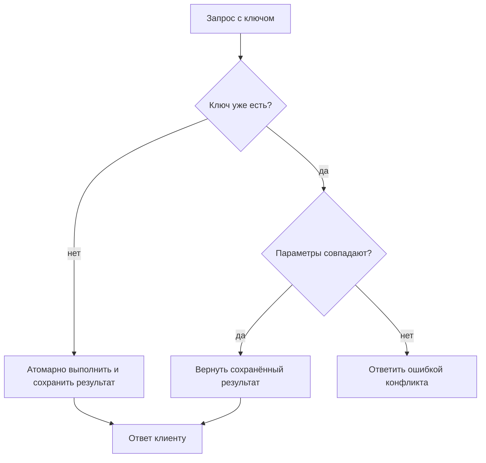

Идемпотентная операция после первого успешного применения сохраняет тот же наблюдаемый результат при повторении с теми же входными данными. В математической записи для операции $f$ это свойство выражают как $f(f(x)) = f(x)$. В распределённой системе обычно говорят о запросе, потому что сеть, клиент или очередь могут доставить одно сообщение несколько раз.

Идемпотентность не означает, что запрос можно повторять бесконечно и без условий. Она требует определить идентификатор операции, границы действия и результат, который должен быть возвращён после повторного вызова.

## Ключ операции

Для записи платежа, создания заказа или публикации события клиент передаёт `idempotency_key`. Сервер сохраняет связь между ключом, параметрами запроса и результатом. Повтор с тем же ключом и теми же параметрами возвращает сохранённый результат, а несовпадение параметров считается ошибкой использования ключа.

```python
from dataclasses import dataclass


@dataclass(frozen=True)
class Result:
    status: int
    body: dict[str, str]


def handle_request(key: str, payload: dict[str, str], store: dict[str, tuple[dict[str, str], Result]]) -> Result:
    previous = store.get(key)
    if previous is not None:
        previous_payload, result = previous
        if previous_payload != payload:
            return Result(409, {"error": "idempotency key reused with different payload"})
        return result

    result = Result(201, {"state": "created"})
    store[key] = (payload, result)
    return result
```

В реальном сервисе проверка и запись должны быть атомарными. Иначе два параллельных запроса могут оба увидеть отсутствие ключа и выполнить действие дважды. Для этого подходят уникальное ограничение в базе данных, транзакция или атомарная операция в хранилище.



> [!NOTE]
> Срок хранения ключа выбирают по максимальному времени возможного повтора. Слишком короткое окно может вернуть проблему двойного выполнения после поздней доставки сообщения.

> [!TIP]
> Логируйте ключ операции вместе с корреляционным идентификатором. Это помогает отличить повтор запроса от двух независимых операций.

## Что проверить

| Сценарий | Ожидаемый результат |
|:--|:--|
| Первый запрос с новым ключом | Действие выполнено, результат сохранён |
| Повтор с тем же телом | Возвращён тот же результат, действие не повторилось |
| Повтор с другим телом | Возвращён конфликт параметров |
| Два параллельных запроса | Только один запрос изменил состояние |
| Повтор после временной ошибки | Правило зависит от того, было ли действие зафиксировано |

Проверка должна включать сбой между фиксацией изменения и отправкой ответа. Именно в этой точке клиент чаще всего решает, что запрос не завершился, и запускает повтор.
