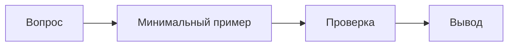
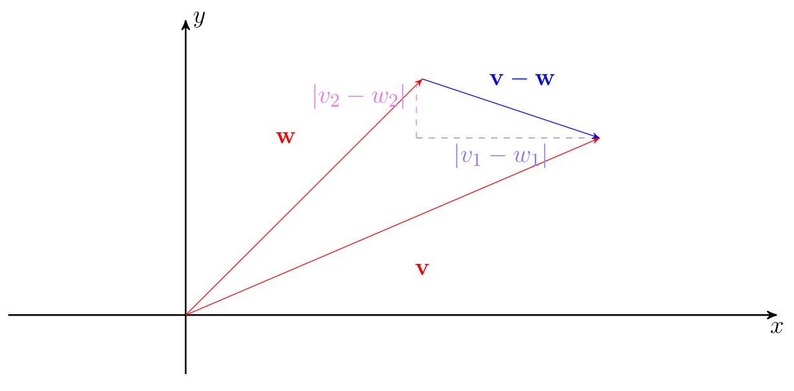
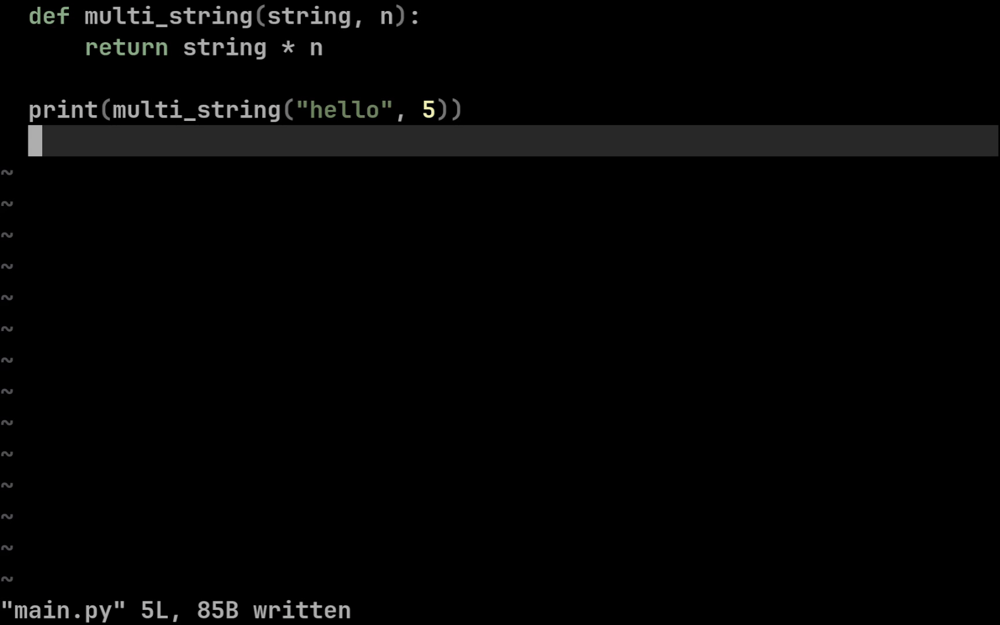

Эта страница — рабочий образец оформления, а не отдельная статья. Здесь можно проверить, как рядом живут кириллица и English, `inline code`, списки, блоки кода, диаграммы, формулы и медиа.

## Текст и структура

Хороший раздел отвечает на один вопрос и заканчивается проверяемым выводом. **Жирное начертание** выделяет ключевую мысль, *курсив* добавляет акцент, а ~~зачёркивание~~ подходит для устаревшего варианта.

> [!NOTE]
> Примечание добавляет контекст, который полезен при первом знакомстве с темой.

> [!WARNING]
> Перед публикацией проверьте внутренние ссылки и доступность прикреплённых ресурсов.

### Списки и задачи

- Сначала сформулировать цель.
- Затем выбрать минимальный пример.
  - Проверить обычный случай.
  - Проверить ошибочный ввод.
- Записать наблюдаемый результат.

1. Открыть страницу.
2. Найти нужный раздел.
3. Сверить пример с исходным условием.

- [x] Добавить короткое объяснение.
- [x] Привести код.
- [ ] Проверить пример в браузере.

## Код и таблица

```python
from dataclasses import dataclass


@dataclass(frozen=True)
class Article:
    title: str
    minutes: int


def total_minutes(articles: list[Article]) -> int:
    return sum(article.minutes for article in articles)


articles = [Article("Идемпотентность", 8), Article("Таймауты", 5)]
print(total_minutes(articles))
```

| Элемент | Для чего нужен | Пример |
|:--|:--|--:|
| Абзац | Объяснить одну мысль | 3 предложения |
| Код | Показать реализацию | 12 строк |
| Диаграмма | Сделать связи видимыми | 4 узла |

## Диаграмма и формула



Короткая формула может быть частью предложения: $a^2 + b^2 = c^2$. Для отдельного выражения подходит блочный вариант:

$$
\operatorname{softmax}(z_i) = \frac{e^{z_i}}{\sum_{j=1}^{n} e^{z_j}}
$$

## Изображения, GIF и видео

Нажмите на изображение, чтобы рассмотреть его крупнее.






<details>
  <summary>Зачем собирать все элементы на одной странице?</summary>
  <p>Так проще проверить типографику, интервалы, медиа и поведение длинного материала в одном месте.</p>
</details>

Русский текст и English могут встречаться в одном абзаце без смены контекста.[^example]

[^example]: Сноска подходит для небольшого уточнения, которое не стоит выносить в основной поток.
